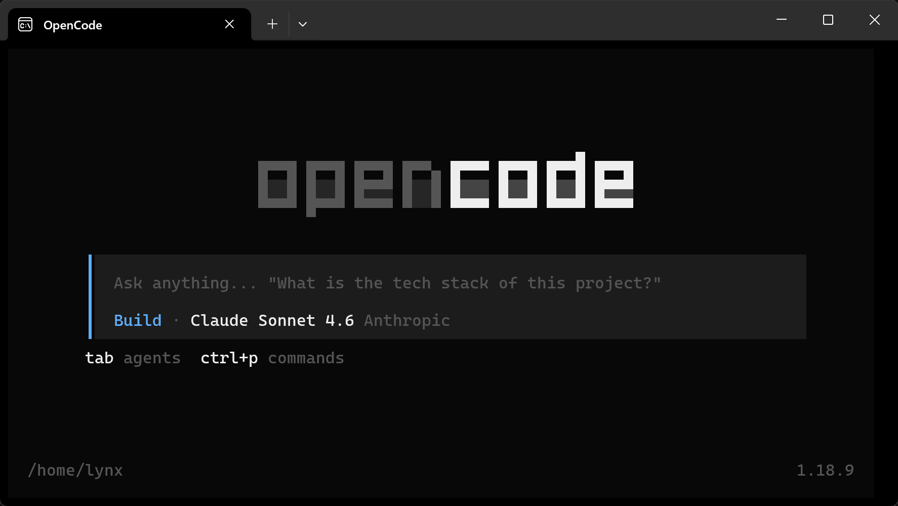

## PHM 关键实体整合 & 数据获取与分析桥接后端 部署文档
### 项目依赖
1. 建议python=3.10
2. 使用sqlite3且数据库物理存储位置为./phm_entity.db
3. 进入项目目录并执行

   ```shell
   $ pip install -r requirments.txt
   ```
   *备选：自行使用python包管理器下载fastapi、uvicorn、sqlalchemy、pydantic、httpx五个依赖库*

### 启动方式
在合规环境下
```shell
$ uvicorn app.main:app --host 0.0.0.0 --port ${分配的端口}
```

### 测试入口
在浏览器中访问 `http://127.0.0.1:{分配的端口}/docs` 可以看到该后端的OPENAPI文档，如图：


## OpenCode后端 部署文档
### 下载opencode（linux）
在root（推荐）用户下下载，指令为
```shell
$ curl -fsSL https://opencode.ai/install | bash
```
此后在终端中测试运行`$ opencode`命令，应显示对话终端TUI界面，如图：


不行就激活一下bash：

```shell
$ source /root/.bashrc #以root下安装为例
```

### 注册工具

在目录`~/.config/opencode`下添加以下两个文件，并**根据实际各工具占用的端口号和web服务的接口路由调整文件内容**：

1. ezagent.ts

   ```typescript
   import { tool } from "@opencode-ai/plugin"
   
   /**
    * ！！！重要！！！
    * API_BASE指定URL中的端口需要调整为实际占用端口号
    *
    */
   const API_BASE = "http://127.0.0.1:8001"
   
   /**
    * ezagent CLI 工具
    *
    * 通过一个小模型驱动的 Web API，将自然语言指令翻译为 `ezcli highlevel` 命令行调用，
    * 并返回格式化后的结果。
    *
    * 小模型已内置对以下 ezcli highlevel 命令的完整理解：
    * - create                   创建并启动临时框架实例（自动生成 UUID、注册路由、无权重加载）
    * - load <id> [--path]       加载模型权重
    * - train <id> <csv> [...]   用 CSV 数据训练
    * - infer <id> <csv> [...]   用 CSV 数据推理
    * - state <id>               查询实例运行状态
    * - restart <id>             重启实例
    * - delete <id>              删除实例
    *
    * 典型生命周期: create → load → train / infer → state → delete（或 restart）
    */
   export default tool({
     description: `AI 驱动的 ezcli 命令行工具。将自然语言指令翻译为 ezcli highlevel 命令并执行，返回结果。
   
   支持的操作：
   - 创建实例：create
   - 加载模型：load（带路径或空载初始化）
   - 训练模型：train（CSV 数据，可指定特征列、标签列、epoch）
   - 推理：infer（CSV 数据，指定输入列）
   - 查询状态：state
   - 重启实例：restart
   - 删除实例：delete
   
   示例：
   - "29430fa9-564e-4c61-8505-5f7b81690de3 这个实例目前的状态是什么？"
   - "帮我创建一个新的算法实例"
   - "用 data.csv 训练实例 abc123，特征列是 f1 f2，标签列是 label，训练 10 轮"
   - "删除实例 abc123"`,
   
     args: {
       user_input: tool.schema
         .string()
         .describe(
           "自然语言描述的 ezcli 操作指令。小模型会自动识别意图并翻译为对应的 ezcli highlevel 命令执行。"
         ),
     },
   
     async execute(args, ctx) {
       const { user_input } = args
   
       // API_BASE变量唯一使用地点
       const response = await fetch(`${API_BASE}/ezagent/interact/tool`, {
         method: "POST",
         headers: {
           accept: "application/json",
           "Content-Type": "application/json",
         },
         body: JSON.stringify({
           context: [],
           user_input,
         }),
         signal: ctx.abort,
       })
   
       if (!response.ok) {
         throw new Error(
           `ezagent 请求失败：HTTP ${response.status} ${response.statusText}`
         )
       }
   
       const data = await response.json()
   
       // 响应格式: { role: "assistant", content: [{ text: "...", type: "input_text" }] }
       const content = data.content
       if (!content || !Array.isArray(content) || content.length === 0) {
         return `ezagent 返回了空响应。`
       }
   
       const lines: string[] = []
       for (const block of content) {
         if (block.type === "input_text" && block.text) {
           lines.push(block.text)
         }
       }
   
       return lines.join("\n") || `ezagent 未返回可展示的文本内容。`
     },
   })
   ```

2. knowledge-retrieval.ts

   ```typescript
   import { tool } from "@opencode-ai/plugin"
   
   /**
    * ！！！重要！！！
    * API_BASE指定URL中的端口需要调整为实际占用端口号
    *
    */
   const API_BASE = "http://192.168.31.13:8001"
   
   export default tool({
     description: `搜索知识库，同时执行 Dense 向量检索和 BM25 关键词检索，通过 Reciprocal Rank Fusion (RRF) 融合排序返回综合最优结果。
   
   示例：
   - 查询"发动机振动异常如何排查"，返回 top 5:
     query="发动机振动异常如何排查", top_k=5
   
   - 查询"液压系统常见故障"，返回 top 3:
     query="液压系统常见故障", top_k=3`,
     args: {
       query: tool.schema.string().describe("检索查询文本，支持自然语言描述"),
       top_k: tool.schema.number().int().min(1).max(50).default(5).describe("返回结果数量，范围 1~50，默认 5"),
     },
     async execute(args, ctx) {
       const { query, top_k } = args
   
       // API_BASE变量唯一使用地点
       const response = await fetch(`${API_BASE}/api/retrieval`, {
         method: "POST",
         headers: { "Content-Type": "application/json" },
         body: JSON.stringify({ query, top_k }),
         signal: ctx.abort,
       })
   
       if (!response.ok) {
         throw new Error(`检索请求失败：HTTP ${response.status} ${response.statusText}`)
       }
   
       const data = await response.json()
   
       if (!data.results || data.results.length === 0) {
         return `未找到与「${query}」相关的结果。`
       }
   
       const lines = [
         `## 知识库检索结果`,
         ``,
         `**查询**: ${data.query}`,
         `**结果数量**: ${data.total}`,
         `**检索耗时**: ${data.retrieval_time_ms?.toFixed(1) ?? "N/A"} ms`,
         ``,
         `---`,
         ``,
       ]
   
       data.results.forEach((r: any, i: number) => {
         lines.push(`### ${i + 1}. ${r.title ?? "无标题"}`)
         lines.push(`- **来源**: ${r.source ?? "未知"}`)
         lines.push(`- **相关度分数**: ${r.score?.toFixed(4) ?? "N/A"}`)
         lines.push(`- **内容**:`)
         lines.push(``)
         lines.push(r.content ?? "(无内容)")
         lines.push(``)
       })
   
       return lines.join("\n")
     },
   })
   ```

### 启动opencode后端

在下载opencode的用户态下执行

```shell
$ opencode serve --log-level "DEBUG" --print-logs --hostname 0.0.0.0 --port ${分配的端口}
```

正常状态下启动后终端应输出以下信息（以默认端口4096为例）：

```shell
Warning: OPENCODE_SERVER_PASSWORD is not set; server is unsecured.
timestamp=2026-07-30T08:08:56.867Z level=INFO run=e52ff686 message=loading path=/root/.config/opencode/config.json
timestamp=2026-07-30T08:08:56.879Z level=INFO run=e52ff686 message=loading path=/root/.config/opencode/opencode.json
timestamp=2026-07-30T08:08:56.883Z level=INFO run=e52ff686 message=loading path=/root/.config/opencode/opencode.jsonc
opencode server listening on http://0.0.0.0:4096
```

